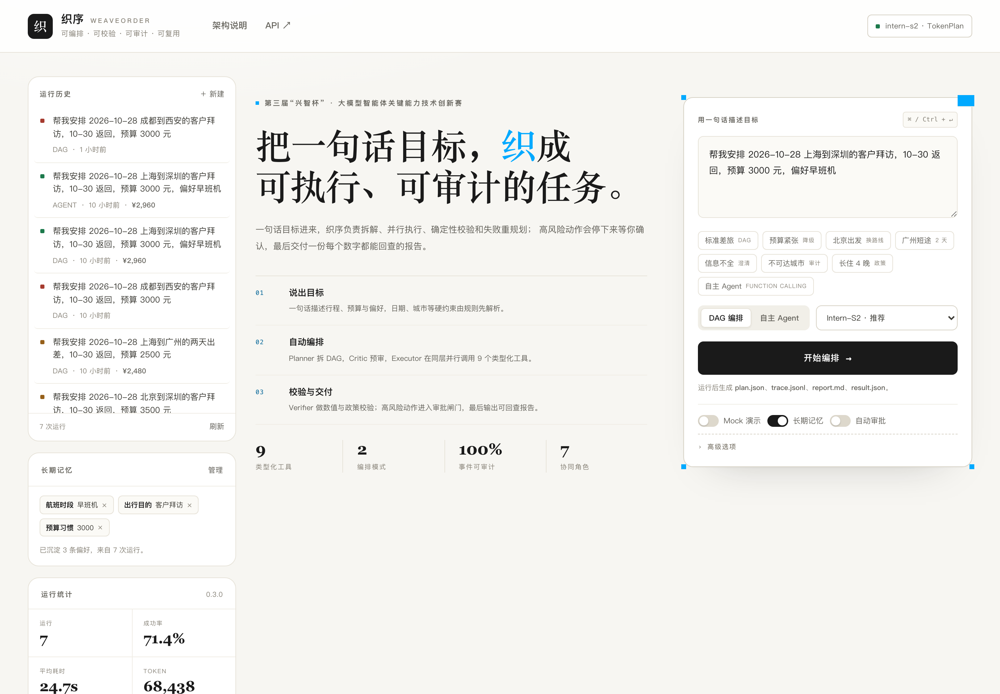
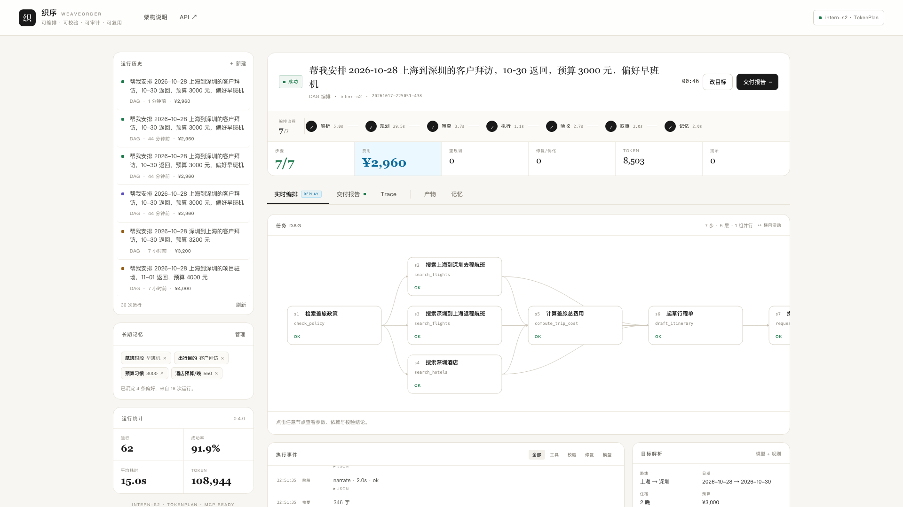
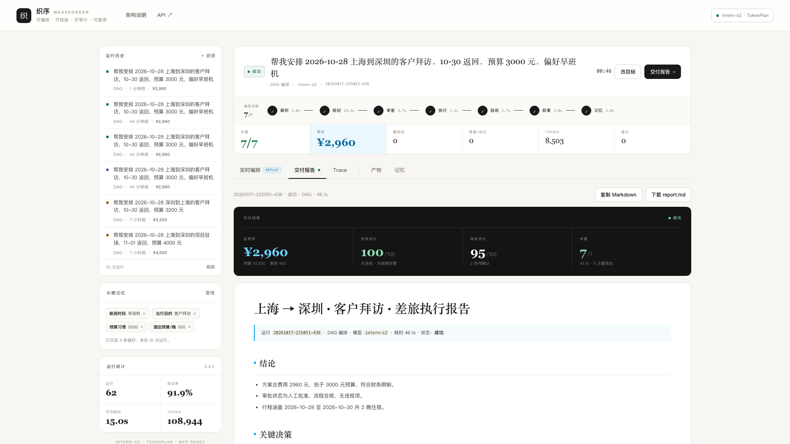
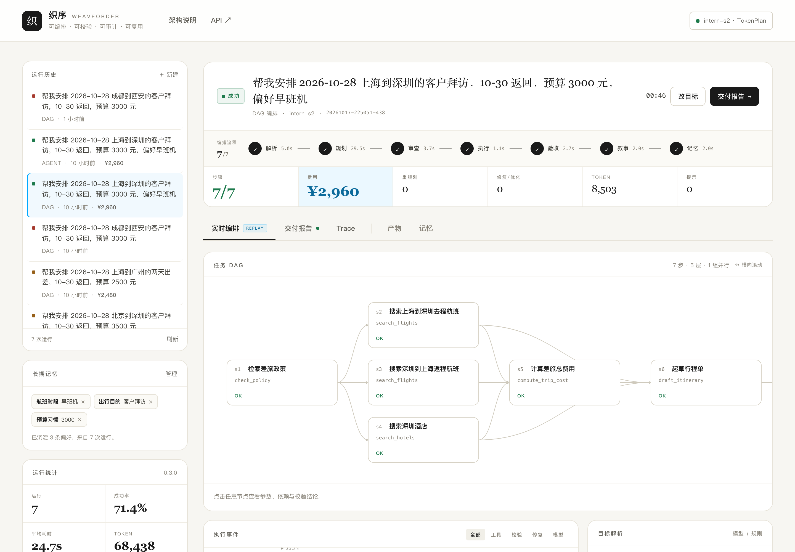
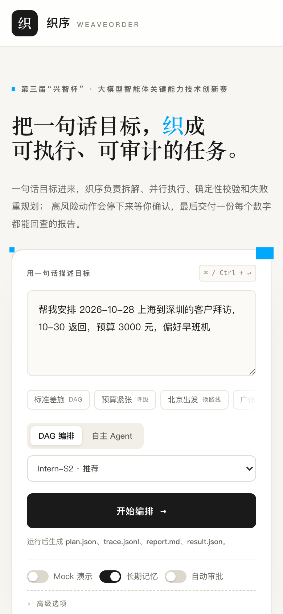

# 织序 WeaveOrder v0.4

**可编排、可校验、可审计、可复用的任务编排智能体** — 第三届“兴智杯”·大模型智能体关键能力技术创新赛参赛项目。

一句话：用户给一句自然语言目标，织序把它拆成可执行的 DAG 或自主工具调用轨迹，并行执行、确定性校验、失败重规划，在高风险动作前暂停等待人工确认，最终产出可追溯的交付报告。



| 实时编排（真实运行） | 交付报告 |
|---|---|
|  |  |
| **任务 DAG** | **移动端** |
|  |  |

技术报告：[docs/技术文档-v0.3.pdf](docs/技术文档-v0.3.pdf)（13 页，含架构、评测与 API 迭代记录）。

---

## v0.4 新增：标准协议与开源生态集成

编排引擎（harness 本体）不变，外围按官方协议规范补齐生态对接，**零新增第三方依赖**（主流框架 SDK 均要求 Python ≥3.10，本项目锁定 3.9+ 可复现）：

| 集成 | 实现 | 说明 |
|---|---|---|
| **A2A 协议** | `a2a_server.py` | Agent2Agent 开放协议（Linux Foundation）：AgentCard 自动发现、`message/send`、`message/stream`（SSE）、`tasks/get`、`tasks/cancel`，兼容 v1.0 方法别名；默认 mock 模式可公开部署 |
| **MCP 升级** | `mcp_server.py` | 协议版本协商（2025-06-18 / 2025-03-26 / 2024-11-05），语义对齐最新 MCP 规范 |
| **Agent Skills** | `core/skills.py` + `skills/` | 按 agentskills.io 开放标准加载 SKILL.md；技能摘要注入自主 Agent 系统提示（上下文工程），并同步进 MCP/A2A 能力声明；新增 `itinerary-audit` 审计技能 |
| **第二场景：经营分析** | `analysis_agent.py` + `core/analysis.py` | §5.2 兑现：`file_read / sql_query（sqlite3 真执行）/ report_render` 与差旅共用引擎原语，只换工具集；校验器独立重算每个报告数字，不一致即拦截 |
| **消融/基线套件** | `eval/run_eval.py --suite ablation` | `ours / w-o-verifier / w-o-replanner / serial-exec` 四变体对照 + 故障注入任务，量化编排层各组件贡献（差旅与分析双场景验证） |

```bash
# A2A Server（无 Key 也能跑，可公开部署给评委体验）
.venv/bin/python a2a_server.py --host 127.0.0.1 --port 8001
curl http://127.0.0.1:8001/.well-known/agent-card.json   # 智能体发现
```

---

## v0.3 做了什么

v0.2 是一个能跑的“最小原型”：单文件 agent、线性执行、硬编码修复、阻塞式 Web 请求。
v0.3 把内核、界面和评测都重做了一遍：

| 能力 | v0.2 | v0.3 |
|---|---|---|
| 规划 | 单次 LLM 生成，失败直接回退规则 | **Planner + Critic** 双角色：先规划、再预审；结构错误自动修复一次 |
| 执行 | 拓扑序串行 | **并行 DAG 执行器**：同层无依赖步骤并发，事件序号保证 trace 可读 |
| 失败恢复 | 硬编码 `s2/s4` 两条路径 | **步骤内确定性修复 → 预算优化器 → LLM Replanner** 三级恢复 |
| 校验 | 少量 if 判断 | **数值一致性 + 政策条款编号 + 预算/红眼/距离/退改 + LLM 验收** 多层校验 |
| 工具 | 7 个函数 | **9 个类型化工具**：JSON Schema 校验/纠偏、超时、只读重试、风险等级 |
| 交互 | POST 等待 1–2 分钟 | **SSE 实时事件流**：阶段、token、工具调用、校验、审批全部实时可见 |
| 审批 | 终端输入 / 自动批准 | **Web 审批闸门**：运行暂停、审批单可拒绝/备注、超时按拒绝处理 |
| 记忆 | 文档里的 TODO | **跨运行偏好画像 + 历史行程**：模型/规则双通道写入，白名单 + 敏感信息过滤 |
| 模式 | 只有 DAG | **DAG 编排 + 原生 Function Calling Agent** 双模式 |
| 可观测 | plan / trace / report | 额外 `result.json`、阶段耗时、Token、重规划、修复、并行指标 |
| 评测 | 2 条 live 用例 | **12 条 Mock 回归 + 4 条 Live 用例**，覆盖降级、失败、无日期、反向路线、Agent |
| 文档 | 技术方案 | README + 架构图 + v0.3 技术报告 + 自动截图 |

---

## 架构

```
                     ┌─────────────────────────────────────────────┐
                     │   Web 控制台（SSE 实时流 / DAG / 审批 / 报告） │
                     └───────────────────────┬─────────────────────┘
                                             │ EventBus（所有状态都是事件）
┌────────────────────────────────────────────▼────────────────────────────────────────────┐
│                                  Orchestrator 编排引擎                                  │
│                                                                                         │
│  Intake ──► Planner ──► Critic ──► 并行 DAG Executor ──► Verifier ──► Narrator          │
│    │           │           │              │                  │             │              │
│    │           └───────────┴──────► Blackboard（结果引用 $s2.best.price）                 │
│    │                                      │                  │             │              │
│    │                               Step Repair / Budget Optimizer           │              │
│    │                                      │                  │             │              │
│    └──────────────► Replanner ◄───────────┴──────────────────┘             │              │
│                                                                             ▼              │
│  Memory（偏好/历史）   Approval Gate（risk ≥ 2 暂停）   Trace（事件溯源）   Report         │
└────────────────────────────────────────────┬────────────────────────────────────────────┘
                                             │
┌────────────────────────────────────────────▼────────────────────────────────────────────┐
│  Tool Registry（9 个工具）                                                                │
│  check_policy · search_flights · search_hotels · compute_trip_cost · draft_itinerary     │
│  policy_compliance · request_approval · get_travel_profile · save_travel_preference     │
└────────────────────────────────────────────┬────────────────────────────────────────────┘
                                             │
                     ┌───────────────────────▼───────────────────────┐
                     │ 书生 TokenPlan（Intern-S2 / 可选快速模型路由）  │
                     └───────────────────────────────────────────────┘
```

### 七个协同角色

| 角色 | 输入 | 输出 | 设计意图 |
|---|---|---|---|
| **Intake** | 一句话目标 | 结构化约束 + 澄清问题 + 假设 | 规则先解析硬约束，模型只补软偏好，避免幻觉覆盖日期/城市 |
| **Planner** | 约束、工具、记忆 | 带 `depends_on` 的 DAG | 严格 JSON Schema + 一次结构修复 + 规则兜底 |
| **Critic** | 计划、约束 | accept / revise + issues | 执行前发现问题，而不是等失败 |
| **Executor** | DAG | 工具结果 + 并行批次 | 同层并行、引用解析、超时、风险闸门 |
| **Verifier** | 行程草案 | 确定性校验 + 语义验收 | 数字必须一致、政策必须带编号、冲突必须显式 |
| **Replanner** | 失败上下文 | 修订后的完整计划 | 保留已完成事实，只改未完成部分 |
| **Narrator / Memory** | 事实、指标 | 可交付摘要 / 跨运行偏好 | 报告可读，经验可复用 |

### 三级失败恢复

1. **步骤内确定性修复**：航班空结果 → 移除过严过滤；酒店空结果 → 放宽价格/星级/距离；费用超预算 → 组合优化器。
2. **预算优化器**：在往返航班 × 酒店的组合中，优先选“预算内 + 政策惩罚最小”的方案；若无解，选最接近预算的方案并**降级 + 审批**，绝不静默。
3. **LLM Replanner**：当步骤内修复无效（工具报错、引用断裂、结构性缺陷），把失败原因、已完成结果、政策阈值交给模型重写计划；最多 2 轮，结果仍需通过静态校验。

---

## 快速开始

```bash
cd weaveorder
python3 -m venv .venv
source .venv/bin/activate
pip install -r requirements.txt

# 不配置 Key 也能跑：规则规划 + 内置确定性数据源
python agent.py --mock --yes "帮我安排 2026-10-28 上海到深圳的客户拜访，10-30 返回，预算 3000 元"

# 配置书生 TokenPlan Key（推荐 Intern-S2）
cp .env.example .env
# 编辑 .env，填入 INTERN_API_KEY
set -a; source .env; set +a

# 真实 LLM + 自动批准
python agent.py --yes "帮我安排 2026-10-28 上海到深圳的客户拜访，10-30 返回，预算 3000 元"

# 原生 Function Calling Agent 模式
python agent.py --yes --mode agent "帮我安排 2026-10-28 上海到深圳的客户拜访，10-30 返回，预算 3000 元"
```

### Web 控制台

```bash
.venv/bin/uvicorn app.server:app --host 127.0.0.1 --port 8000
# 打开 http://127.0.0.1:8000
```

界面能力：

- **实时编排**：阶段进度、DAG 节点状态、每一条工具调用/校验/修复事件、模型 token 流。
- **审批闸门**：`risk ≥ 2` 的动作弹窗暂停，批准/拒绝都会写入 Trace；超时按拒绝。
- **交付报告**：摘要、行程、费用、政策引用、执行表、指标、审计说明。
- **Trace / 产物**：完整事件、可下载 `plan.json` / `trace.jsonl` / `report.md` / `result.json`。
- **长期记忆**：偏好画像、最近行程、手动增删偏好。
- **历史回放**：任意历史运行的 DAG、事件流与报告。

### MCP server

```bash
.venv/bin/python mcp_server.py
```

stdio JSON-RPC，无需 MCP SDK，暴露 9 个工具，可被 Claude Code / OpenClaw 等支持 MCP 的 harness 调用：

```json
{
  "mcpServers": {
    "weaveorder-travel": {
      "command": "/Users/ryan/Desktop/兴智杯/weaveorder/.venv/bin/python",
      "args": ["/Users/ryan/Desktop/兴智杯/weaveorder/mcp_server.py"]
    }
  }
}
```

### Agent Skills

按 [agentskills.io 开放标准](https://agentskills.io/specification)组织的技能包，可被织序、Claude Code 等任何支持该标准的 harness 加载：

- `skills/travel-orchestration/SKILL.md` — 差旅编排：工具顺序、政策阈值、安全边界；
- `skills/itinerary-audit/SKILL.md` — 行程审计：重算费用、核对政策与审批记录，输出结构化审计意见。

技能由 `core/skills.py` 加载：自主 Agent 模式注入系统提示，`GET /api/skills` 与 A2A AgentCard 对外声明。

### A2A Server

```bash
.venv/bin/python a2a_server.py --host 127.0.0.1 --port 8001
# 默认 mock 模式（无需 Key）；--live 启用真实书生模型
```

| 端点 | 说明 |
|---|---|
| `GET /.well-known/agent-card.json` | 智能体发现（含 v1.0 `supportedInterfaces` 与技能列表） |
| `POST /` `message/send` | 同步执行一次编排，返回 Task + 报告 artifacts |
| `POST /` `message/stream`（`Accept: text/event-stream`）或 `POST /stream` | SSE 流式状态与产物 |
| `POST /` `tasks/get` / `tasks/cancel` | 任务查询与协作式取消 |

---

## 评测

```bash
# 确定性回归（秒级，12/12）
.venv/bin/python eval/run_eval.py --mode mock

# 真实书生模型（推荐 Intern-S2 规划 + 快速模型做结构化抽取）
.venv/bin/python eval/run_eval.py --mode live --limit 4
.venv/bin/python eval/run_eval.py --mode live --task T01 --task T13

# 消融/基线套件（技术方案 §6.3/§6.4）
.venv/bin/python eval/run_eval.py --suite ablation --mode mock
.venv/bin/python eval/run_eval.py --suite ablation --mode live --task T01 --task T02

# 第二场景：经营分析（§5.2，含注入/消融对照）
python analysis_agent.py "分析 2026Q3 销售数据，定位华东 9 月环比下滑的原因，重点关注数码品类"
.venv/bin/python eval/run_eval.py --suite analysis
```

最近结果：

- **Mock：12/12 通过**，见 [eval/results-mock.md](eval/results-mock.md)。
- **Live（Intern-S2 规划 + Qwen 结构化路由）：2/2 通过**，见 [eval/results-live-intern.md](eval/results-live-intern.md)。
  - T01 标准差旅：状态 `ok`，¥2960，50.3s，7,034 tokens，7/7 步。
  - T13 自主 Agent：状态 `ok_with_warnings`，¥2990，64.9s，49,781 tokens，9 次工具调用。
- **Live（Qwen 全快模型）：4/4 通过**，总耗时 89.3s，见 [eval/results-live.md](eval/results-live.md)，覆盖降级、失败审计与 Agent。
- **消融/基线（Mock 确定性）**：`ours` 5/5；`w/o-verifier` 仅 1/5（预算无解被误报 ok、注入故障扩散失败）——校验层是约束满足率的决定性组件，见 [eval/results-ablation-mock.md](eval/results-ablation-mock.md)。
- **消融/基线（Live，Intern-S2 真实运行 12 次）**：`ours` 3/3；`w/o-verifier` 1/3（¥2960 超预算误报 ok、注入故障重规划 2 轮仍失败），见 [eval/results-ablation-live.md](eval/results-ablation-live.md)。
- **第二场景（经营分析）：6/6 通过**，黄金值由评测脚本独立重算；同一注入在校验开时被拦截（-29.2% ≠ 重算 -58.4%）、校验关时错误发布——校验原语跨场景成立，见 [eval/results-analysis.md](eval/results-analysis.md)。
- 覆盖：标准差旅、预算无解降级、航班空结果恢复、北京/广州/反向路线、缺日期、中文日期、不可达城市、1 晚/4 晚、自主 Agent。

> Live 模式不要求与 Mock 完全同价；只要求方案可交付、预算内、冲突显式、Trace 完整。

---

## 书生模型接入细节

### 为什么快

Intern-S2 默认会先输出 `reasoning_content`。v0.3 对**结构化任务**显式关闭思考：

```python
extra_body={"thinking": {"type": "disabled"}}
```

规划耗时从分钟级降到秒级，同时保留 `INTERN_THINKING=1` 或 UI“深度思考”开关用于难题。

### 模型路由

| 角色 | 默认模型 | 原因 |
|---|---|---|
| Planner / Replanner | `INTERN_MODEL`（默认 `intern-s2`） | 需要更强的规划与失败推理能力 |
| Critic / Narrator | `INTERN_FAST_MODEL`（默认 `qwen3.8-27b`） | 审查与总结可接受轻量模型，显著降低总耗时 |
| Intake / Verifier / Memory | `INTERN_FAST_MODEL`（默认 `qwen3.8-27b`） | 结构化抽取，低风险、低延迟 |
| Agent 模式 | `INTERN_MODEL` | 原生 Function Calling |

所有角色都可以用 `.env` 覆盖：

```bash
INTERN_MODEL=intern-s2
INTERN_FAST_MODEL=qwen3.8-27b
INTERN_PLANNER_MODEL=
INTERN_CRITIC_MODEL=
INTERN_REPLANNER_MODEL=
INTERN_NARRATOR_MODEL=
INTERN_INTAKE_MODEL=fast
INTERN_VERIFIER_MODEL=fast
INTERN_MEMORY_MODEL=fast
```

### 已处理的坑

- **代理导致 `Invalid port: ':1]'`**：httpx 0.28 无法解析 `NO_PROXY=[::1]`。`core/config.py` 会在启动时清理方括号 IPv6 条目，保留其余代理设置。
- **空 content**：思考 token 吃满 `max_tokens` 时自动关闭思考并放大额度重试一次。
- **JSON 截断/加壳**：优先 `response_format=json_object`，失败时从文本中抽取 JSON，再让修复器修一次。
- **模型爱写 `dag/action/params`**：Planner 同时做字段适配 + 严格提示词；最终仍以 Schema 校验为准。

---

## API

| 方法 | 路径 | 说明 |
|---|---|---|
| `GET` | `/api/health` | 版本、模型、Key、工具数、能力 |
| `GET` | `/api/models` | 书生 TokenPlan 可用模型 + 推荐 |
| `GET` | `/api/examples` | 演示目标 |
| `GET` | `/api/tools` | 工具 Schema |
| `POST` | `/api/runs` | 创建运行（`mode=dag/agent`，`auto_approve` 控制审批） |
| `GET` | `/api/runs` | 运行历史 + 待审批 |
| `GET` | `/api/runs/{id}` | 完整结果 |
| `GET` | `/api/runs/{id}/events` | SSE 事件流（支持回放） |
| `POST` | `/api/runs/{id}/approve` | 批准/拒绝审批单 |
| `POST` | `/api/runs/{id}/cancel` | 取消运行 |
| `GET` | `/api/runs/{id}/artifacts/{name}` | 下载产物 |
| `GET/POST/DELETE` | `/api/memory` | 长期记忆读写/清空 |
| `GET` | `/api/stats` | 聚合指标 |

运行产物：

```
runs/<run_id>/
├── plan.initial.json     # 初始计划
├── plan.json             # 最终计划
├── plan.replan-1.json    # 重规划快照（如有）
├── trace.jsonl           # 全量事件
├── result.json           # 结构化结果
└── report.md             # 交付报告
```

---

## 目录

```
weaveorder/
├── agent.py                  # CLI（差旅场景）+ 向后兼容导出
├── analysis_agent.py         # CLI（经营分析场景：§5.2 第二场景）
├── core/
│   ├── config.py             # 环境、路径、模型路由、代理修复
│   ├── events.py             # EventBus / SSE
│   ├── llm.py                # 书生客户端：思考开关/JSON/流式/统计
│   ├── intake.py             # 目标解析（规则 + LLM 补位）
│   ├── plan.py               # DAG 数据结构、校验、$ref 解析
│   ├── catalog.py            # 确定性航班/酒店数据源
│   ├── policy.py             # 政策检索 + 合规规则引擎
│   ├── tools.py              # 9 个类型化工具
│   ├── analysis.py           # 分析场景工具（file_read/sql_query/report_render）
│   ├── memory.py             # 偏好画像 + 历史行程（可替换外部后端）
│   ├── skills.py             # Agent Skills 加载器（agentskills.io 标准）
│   ├── agents.py             # Intake/Planner/Critic/Verifier/Replanner/Narrator/Memory
│   ├── engine.py             # 并行 DAG + 审批 + 修复 + Agent 模式 + 消融开关
│   └── report.py             # Markdown 交付报告
├── app/
│   ├── server.py             # FastAPI + SSE + 历史 + 审批 + 记忆
│   └── static/index.html     # 单页控制台（无构建步骤）
├── data/policy.md            # 可引用编号的差旅政策
├── data/sales_2026Q3.csv     # 分析场景确定性数据集（含缺失值）
├── eval/                     # 评测任务/脚本/结果（主套件 + 消融/基线）
├── skills/                   # Agent Skills（travel-orchestration / itinerary-audit）
├── mcp_server.py             # stdio MCP server（协议版本协商）
├── a2a_server.py             # A2A server（AgentCard + JSON-RPC + SSE）
└── docs/                     # 技术报告、演示脚本、截图
```

---

## 与赛题要求的对照

| 官方要求 | v0.3 实现 | 证据 |
|---|---|---|
| 基于书生大模型 | Intern-S2（TokenPlan，OpenAI 兼容）+ 角色化模型路由 | `core/llm.py`、`/api/models`、live 评测 |
| 任务自主规划 | LLM Planner + Critic + 静态 DAG 校验 + Replanner | `plan.json`、`plan.replan-*.json`、Trace |
| 工具调用 | 9 个类型化工具 + JSON Schema 校验/纠偏 + 超时/重试 + 风险等级 | `/api/tools`、`tool_call`/`tool_result` |
| 多步推理 | Blackboard 结果引用 + 并行调度 + 数值/政策/完整性校验 | DAG、Verifier、报告 |
| 多智能体协同 | 7 个角色、结构化输入输出、独立 prompt 与模型路由 | `core/agents.py` |
| 上下文工程 | 压缩工具描述、结果摘要、记忆上下文、失败上下文 | `engine.py`、`agents.py` |
| 长周期记忆 | 偏好画像 + 历史行程 + 白名单校验 + UI 管理 | `memory/`、`/api/memory` |
| MCP / Agent Skills | stdio MCP server（版本协商）+ agentskills.io 标准 SKILL.md | `mcp_server.py`、`skills/`、`/api/skills` |
| A2A 智能体互通 | AgentCard 发现 + message/send/stream + tasks API | `a2a_server.py` |
| 可审计 | 全量事件、审批记录、产物快照 | `trace.jsonl`、报告“可审计性” |
| 可运行、可复现 | CLI + Web + Mock + 12 条回归 | 一键命令 |

---

## 设计原则

1. **先能跑，再变强**：没有 Key 也能用 Mock 演示完整链路；有 Key 时自动切换真实模型。
2. **确定性优先**：日期/城市/价格/政策阈值由代码判定，模型只做选择与解释。
3. **失败是常态**：空结果、超预算、不可达城市、模型 JSON 错误都有明确恢复路径。
4. **高风险动作必须人工确认**：审批是引擎能力，不是提示词约定。
5. **每个数字可回查**：报告结论 → 工具调用 → 参数 → 返回值，整条链路都在 Trace 里。
6. **不编造**：数据源不覆盖就失败并说明；模型输出必须通过 Schema 与校验。

## 已知限制与下一步

- 数据源为确定性 Mock（比赛环境不依赖外部票务 API），接入真实票务/地图 API 只需替换 `core/catalog.py`。
- Agent 模式目前是单 Agent + 工具循环，可扩展为多 Agent 分工（Planner Agent / Booking Agent / Policy Agent）。
- 记忆目前是单用户文件存储，生产可替换为向量库 + 用户维度隔离。
- 演示视频已更新为 v0.4：**带口播讲解 + 真实操作录屏的 4 分 58 秒版本**（`docs/demo.mp4`，含产品控制台实际操作、审批与报告，2:45–3:10）；另附 112 秒纯动效快剪版 `docs/demo-trailer.mp4`。技术文档 v0.4 PDF 在 `docs/` 下持续更新。

## 赞助与致谢

感谢书生 TokenPlan 提供 Intern-S2 等模型接口；本项目所有模型调用均通过 `discovery-api.intern-ai.org.cn` 的 OpenAI 兼容入口完成。
