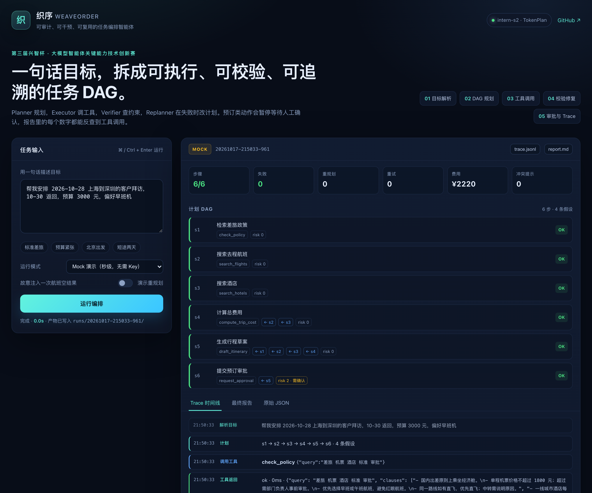

# 织序 WeaveOrder

**可审计、可干预、可复用的任务编排智能体** — 第三届“兴智杯”·大模型智能体关键能力技术创新赛参赛项目。

## 一句话

用户只给一句自然语言目标，织序负责把它拆成可执行的任务 DAG，调用工具、校验结果、失败重规划，并在高风险动作前请求人工确认，最终产出可追溯的执行报告。



## 赛题对齐（官方口径，2026-10-17 取自官网赛题 API）

- 赛道：第三届兴智杯·技术创新·大模型智能体关键能力技术创新赛（id 160，上海人工智能实验室支持）
- 定位：官方“方向 3：开放赋能智能体”——自主选题、需求拆解、工具编排、任务自主规划、结果稳定输出，形成可直接复用的轻量化智能体方案；同时也落在方向 2 的企业差旅场景。
- 硬性要求：必须基于书生大模型；可结合任意 harness，以及 MCP、A2A、Agent Skills、多智能体协同编排、上下文工程、长周期记忆等技术。
- 评分：完整性 30% / 实用性 40% / 技术实现难度 30%。
- 提交：一个 zip，内含技术文档 PDF（含 ≤5 分钟、≥720P 的视频链接和应用体验链接）与关键代码/模型文件。

## 为什么是它

赛题考察的三项关键能力，正好对应引擎的三层：

| 赛题能力 | 织序的实现 |
|---|---|
| 自主规划 | Planner 生成带依赖关系的 DAG；Verifier 失败时触发 Replanner |
| 工具调用 | 类型化 Tool Registry + JSON Schema 参数校验 + 超时/重试 + 结果引用 |
| 多步推理 | Blackboard 汇总中间结果；依赖调度；数值/政策/完整性校验 |

主场景是**企业差旅编排**：一句话完成“查政策 → 搜航班 → 搜酒店 → 算预算 → 校验合规 → 人工确认 → 出行程单”。第二个场景是**经营分析报告**，用于证明引擎不是只能做单一任务。

## 当前状态

已经可运行：

- 编排引擎：规划、依赖调度、工具调用、校验、一次修复/重规划、审批闸门、Trace
- 差旅场景：政策检索、航班/酒店 mock 搜索、费用计算、行程草案
- 无 API Key 的 `--mock` 模式，便于离线演示
- 书生 Intern-S2 的 TokenPlan 接入（`discovery-api.intern-ai.org.cn`），真实 LLM 规划已跑通
- Web UI：计划 DAG、Trace 时间线、报告、失败注入、费用/重规划指标
- MCP server：stdio JSON-RPC，暴露 7 个工具，可被 Claude Code/OpenClaw 等 harness 调用
- Agent Skill：`skills/travel-orchestration/SKILL.md`

进行中：提交 zip 与最后的手册对齐。

## 演示视频与评测

- 1080P 演示视频（约 1 分 30 秒）：[docs/demo.mp4](docs/demo.mp4)
- Mock 功能评测：10/10 通过，见 [eval/results-mock.md](eval/results-mock.md)
- 真实 LLM 评测（Intern-S2）：2/2 通过，见 [eval/results-live.md](eval/results-live.md)
- 技术文档：[docs/技术文档.pdf](docs/技术文档.pdf)

## 快速开始

```bash
cd weaveorder
python3 -m venv .venv
source .venv/bin/activate
pip install -r requirements.txt

# 不配置 API Key 也能跑：使用内置规则规划和 mock 数据
python agent.py --mock "帮我安排 2026-10-28 上海到深圳的客户拜访，10-30 返回，预算 3000 元，偏好早班机"

# 配置书生 API Key 后，使用 LLM 规划
cp .env.example .env
# 编辑 .env，填入 INTERN_API_KEY
set -a; source .env; set +a
python agent.py "帮我安排 2026-10-28 上海到深圳的客户拜访，10-30 返回，预算 3000 元"
```

### Web UI

```bash
.venv/bin/uvicorn app.server:app --host 127.0.0.1 --port 8000
# 打开 http://127.0.0.1:8000
```

页面可以切换 Mock / 真实 LLM，勾选“注入一次航班空结果”看重规划，右侧展示计划 DAG、Trace 时间线、报告和费用指标。

### MCP server

```bash
.venv/bin/python mcp_server.py
```

这是一个 stdio JSON-RPC MCP server，不需要额外的 MCP SDK，暴露 `check_policy`、`search_flights`、`search_hotels`、`compute_trip_cost`、`calculator`、`draft_itinerary`、`request_approval` 七个工具。可以把下面的配置加到支持 MCP 的 harness（路径按实际修改）：

```json
{
  "mcpServers": {
    "weaveorder-travel": {
      "command": "/Users/ryan/Desktop/兴智杯/weaveorder/.venv/bin/python",
      "args": ["/Users/ryan/Desktop/兴智杯/weaveorder/mcp_server.py"]
    }
  }
}
```

运行后会在 `runs/<时间戳>/` 下生成：

- `plan.json`：规划结果
- `trace.jsonl`：逐步执行轨迹
- `report.md`：最终行程草案 + 执行摘要

## 目录

```
weaveorder/
├── agent.py                 # 最小可运行原型（编排引擎 + 差旅工具 + CLI）
├── data/
│   ├── policy.md            # 差旅政策（mock）
│   ├── flights.json         # 航班（mock）
│   └── hotels.json          # 酒店（mock）
├── docs/
│   ├── 01-前置准备清单.md
│   ├── 02-技术方案.md
│   ├── 03-提交材料清单.md
│   └── 04-演示脚本.md
├── requirements.txt
└── .env.example
```

## 已验证

在当前环境用 Python 3.9.6 跑过：

- `python3 -m py_compile agent.py` 通过
- mock 正常路径：政策 → 航班 → 酒店 → 费用 → 行程 → 审批，全链路通过
- `--inject-failure`：航班空结果 → 校验失败 → 放宽价格上限 → 恢复
- 预算 2000：总费用超预算 → 压缩航班/酒店 → 修复，并输出“红眼航班/远距离酒店”冲突提示
- 审批：输入 `y` 通过，输入 `n` 标记 `skipped`

- 真实 LLM 规划（`intern-s2`，`discovery-api.intern-ai.org.cn`）：7 步计划、`compute_trip_cost` 费用计算、审批步骤全链路通过，无 `plan_fallback`
- 注意 `intern-s2` 的 reasoning 会消耗较多 token，`INTERN_MAX_TOKENS` 默认 8192

## 常见问题

- **接口返回 `401 / A0211 user token expired`**：先确认 `INTERN_BASE_URL=https://discovery-api.intern-ai.org.cn/v1`。这是 TokenPlan 的 OpenAI 兼容入口；如果误用 `chat.intern-ai.org.cn`，即使 token 刚创建也会报这个错。URL 正确后再检查 token 是否真的过期（登录 https://internlm.intern-ai.org.cn/api/tokens 重新生成）。代码会自动回退到规则规划，不会中断演示。
- **模型返回空 content / JSON 被截断**：`intern-s2` 会先输出 `reasoning_content`，规划任务可能消耗 5k–7k reasoning tokens。默认已设 `INTERN_MAX_TOKENS=8192`，不要调到 4096 以下，否则 content 会被截断。
- **报错 `Using SOCKS proxy, but the 'socksio' package is not installed`**：本机配置了 SOCKS 代理。执行 `pip install "httpx[socks]"`，或在运行时临时 `unset ALL_PROXY`。
- **`--mock` 和真实 Key 的区别**：`--mock` 不调用模型，用规则规划 + mock 数据，适合没有网络/Key 时演示；去掉 `--mock` 才会走 LLM 规划。

## 设计原则

1. **先能跑，再变强**：mock 模式保证没有 Key、没有网络也能演示核心编排流程。
2. **每一步可解释**：计划、参数、工具返回、校验结论都进 Trace，报告里的结论能反查到工具调用。
3. **失败是常态**：无航班、超预算、政策不符都要有修复路径，而不是直接报错。
4. **高风险动作必须人工确认**：预订、付款、发送类工具默认 `risk >= 2`，执行前暂停。

## 与官方要求的对照

| 官方要求 | 当前实现 | 状态 |
|---|---|---|
| 基于书生大模型 | Intern-S2（TokenPlan，OpenAI 兼容） | 已完成并跑通 |
| 工具调用 / 任务规划 | Tool Registry + DAG Planner + Verifier + Replanner | 已完成 |
| 多智能体协同 / 上下文工程 | Planner–Executor–Verifier–Replanner 角色化编排 + Trace | 已完成 |
| MCP / Agent Skills | 自定义工具层；MCP server 与 Skill 封装 | 待补 |
| 长周期记忆 | 用户偏好与历史计划记忆 | 待补 |
| 可运行、可复现 | CLI + `--mock` + 真实 LLM 双路径 | 已完成 |
| 提交材料 | 代码、技术文档、演示视频、提交 zip | 进行中 |

官方赛题原文与提交格式已整理到 `docs/01-前置准备清单.md`。剩余的信息只需要从平台确认：是否需要统一评测入口、技术文档模板、压缩包 50MB 限制下如何放视频链接。
